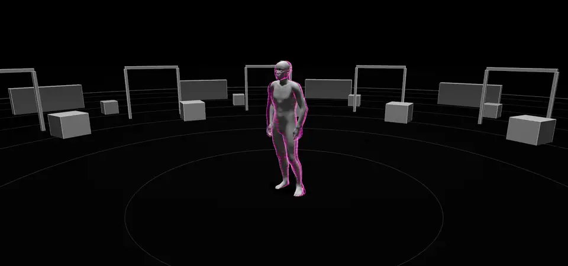
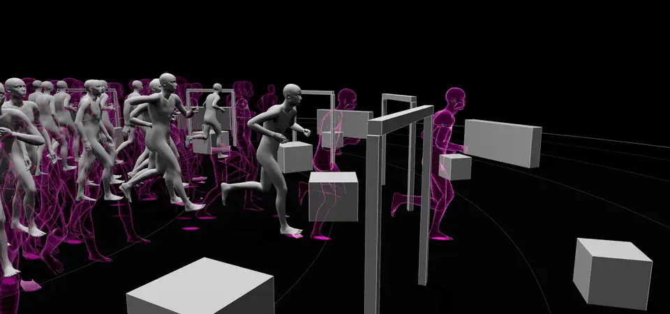

# crowdbricks

Batched [NVIDIA MotionBricks](https://github.com/NVlabs/motionbricks): generate the motion of hundreds of characters in one model call.

<p align="center">
  
</p>

MotionBricks generates character motion one request at a time: four poses of context, up to four target poses, and about two seconds of motion back. That is quick for one character (2.6 ms on an RTX 4090) and slow for a crowd, because every character waits its turn. crowdbricks builds the same ONNX model as a TensorRT plan with a batch dimension, gives MotionBricks' SOMA encode, decode and endpoint kernels that batch dimension too, and adds a light crowd runtime that decides who generates when. A batch of 48 takes 4.7 ms, so 48 characters cost less than two do one at a time.

Above, `examples/futures.py`: one character forks into 48 copies with the same past, and each copy heads for a different obstacle. Pink is each one's plan: the motion the model has generated and the character has not played yet.

## Numbers

RTX 4090, FP16, median of 50 runs (`benchmarks/throughput.py`). Every request is a full generation: a start from standing into a run.

|                     | GPU ms | wall ms | generations/s | ms each |
| ------------------- | -----: | ------: | ------------: | ------: |
| upstream, 1 request |   2.54 |    2.57 |           389 |   2.573 |
| batched, 16         |   3.03 |    3.38 |         4,727 |   0.212 |
| batched, 48         |   4.33 |    4.66 |        10,307 |   0.097 |

In a crowd, characters ask for motion as they reach the end of what they are playing, so batches fill on their own:

- `examples/horde.py`: 192 characters chase a moving point at 60 Hz. 215 generations a second in full batches of 16, 3.7 ms of GPU a batch, and a step of the whole crowd takes 2.4 ms (median).
- `examples/futures.py`: the fork's first 48 motions come from one call. Over 9 s the 48 futures generate 672 motions in 90 batches.

## Quick start

crowdbricks runs on top of a MotionBricks checkout. Set that up first, as its README says (an NVIDIA GPU, [Git LFS](https://git-lfs.com/) and [uv](https://docs.astral.sh/uv/)):

```sh
git clone https://github.com/NVlabs/motionbricks
cd motionbricks
git lfs pull
uv sync
cd ..
```

Then run crowdbricks with MotionBricks' Python and its checkout on `PYTHONPATH` (crowdbricks uses its `app` package, which it does not install):

```sh
git clone https://github.com/patch-gg/crowdbricks
cd crowdbricks
export PYTHONPATH=$PWD/../motionbricks
../motionbricks/.venv/bin/python examples/futures.py --record futures.take
../motionbricks/.venv/bin/python examples/horde.py --record horde.take
```

The first run of each batch size and precision builds a TensorRT plan into `trt-cache/`, which takes a few minutes.

To watch a take, export the character mesh from your checkout once, then serve the folder:

```sh
../motionbricks/.venv/bin/python viewer/export_character.py
python3 -m http.server 8000
```

and open `http://localhost:8000/viewer/?take=../futures.take`, or drop a take on the page.

## Use it

```python
import warp as wp
from app.runtime.common.rig import load_rig_assets
from motionbricks.model.contract import ModelRig

from crowdbricks import Approach, BatchGenerator, Crowd, GaitLibrary, Obstacle, Stand, Walk, obstacle_pool

wp.init()
assets = load_rig_assets(ModelRig.SOMA)
generator = BatchGenerator(assets, batch=16, capacity=64, cache_dir="trt-cache")
gaits = GaitLibrary(assets, generator.stream)  # idle, walk, jog, run and upstream's six style gaits
crowd = Crowd(generator, gaits)

# A wall to vault, as upstream's jump_0_75m Smart Primitive, facing an approach along +x.
wall = Obstacle(obstacle_pool(assets), "vault", (6.0, 0.0), -90.0, generator.stream)

me = crowd.spawn((0.0, 0.0), heading=(1.0, 0.0))
crowd.drive(me, Approach(wall, gaits["run"], then=Walk(gaits["jog"], heading=(1.0, 0.0), distance=2.0)))
for other in crowd.fork(me, 7):  # seven more characters with the same past
    crowd.drive(other, Walk(gaits["zombie"], heading=(-1.0, 0.0), distance=3.0, then=Stand()))

while crowd.clock < 6.0:
    frame = crowd.step(1 / 60)  # frame.slots, frame.packed: root position + 30 joint quaternions each
```

The pieces:

- **`BatchGenerator`** holds the batched plan and a motion bank on the GPU: every character's current motion. `generate(requests, times)` runs up to `batch` requests at once, each one character's next motion, from the four poses it just played toward one to four target poses, with its own allowed token counts. Short batches are padded and the padding is thrown away.
- **`Crowd`** steps every character, asks each one's driver for its next request near the end of its motion, and batches the requests. Requests wait up to `LOOKAHEAD` (0.15 s) for each other so batches fill; a batch runs as soon as anyone would otherwise run out of motion.
- **Drivers** decide what a character does next: `Walk` (a gait, toward a goal or along a heading), `Stand`, `Approach` (walk to an obstacle and use it when the probe box reaches it), `Interact` (step through a Smart Primitive sequence), `Seated` and `sit()`. Subclass `Driver` for your own.
- **`GaitLibrary`** blends upstream's locomotion targets once per gait: walk, jog and run from the Forward mode, idle, and the Scene Preview style modes (skipping, vogue, injured torso, injured leg, zombie, combat).
- **`Obstacle`** wraps one of upstream's Smart Primitives: vault (`jump_0_75m`), hop (`jump_0_5m`), duck (`avoidance`) and sit. It picks the sequence closest to the character's speed and aligns the pivot to its approach, as `VelocityMatchingSequenceBehavior` does, so many characters can share one obstacle from different angles.
- **`Recorder`** writes a take: every character's pose each step and every generated motion with its foot contacts, for `viewer/`.

## How it works

<p align="center">
  
</p>

- **One plan, many requests.** The ONNX model is the one upstream ships; `TensorRTBuildOptions(batch_size=B)` builds it with a batch dimension, and the CUDA graph upstream bakes for one request covers the whole batch.
- **Batched kernels.** `kernels.py` follows MotionBricks' SOMA kernels line for line with the request as the first index: world poses, heading alignment, feature encoding, conditions, decoding and endpoint correction. Conditions are per request, so one batch can mix a sit (one target pose) with runs (four) and styles with their own token counts.
- **Playback on the GPU.** Each character's motion stays on the GPU; sampling, packing and building the next context never leave it. A fork copies a character's motion to new slots, so futures share their past exactly.
- **What it leaves out.** Upstream's character runtime also pins hands and feet to targets with IK (vault hands may land a little off the wall here), plays idle and sitting clips (a crowd character generates toward the idle target instead), and smooths input with springs. crowdbricks keeps a character to a few numbers and a driver so a whole crowd steps in about the time upstream takes for one.

## Matches upstream

`tests/test_matches_upstream.py` builds the same requests through upstream's `MotionBricksSOMAEngine` and through `BatchGenerator`. With a batch of one, crowdbricks builds the very plan upstream uses, so only the kernels differ: in FP32 the root agrees to 11 micrometers and every joint to the precision of the comparison (0.1 degree).

FP16 is looser, for upstream as much as for crowdbricks. The pose module picks discrete codebook tokens, and on some requests FP16 rounding flips a pick: moving upstream's own context by 10 micrometers turns a jog's joints by 6 degrees, and turning a run's target by a thousandth of a degree moves a joint by 15 (both ends stay pinned by the endpoint correction). Each batch size is also its own plan with its own kernels. The FP16 test therefore asks bigger batches for the same length of motion and close agreement on average.

```sh
../motionbricks/.venv/bin/python -m pytest tests/ -s
```

## Takes

`Recorder.save()` writes `CBT1`, a little-endian u32 header length, a JSON header, then the arrays it points at (`{offset, length, dtype}` from the end of the header). Per step: an alive mask, root positions and 30 model-joint quaternions (int16) for every slot. Per generation: the character, when it started, its frames packed the same way, foot contacts, foot positions and its target poses. `viewer/viewer.js` reads it.

## Licenses

crowdbricks is Apache-2.0 ([LICENSE](LICENSE)). `crowdbricks/kernels.py` adapts NVIDIA's MotionBricks kernels, also Apache-2.0; see [NOTICE](NOTICE).

crowdbricks ships nothing of MotionBricks itself. The models (NVIDIA Open Model Agreement), the SOMA rig, the Smart Primitives and the sample motion clips load from your checkout under their own terms. Gaits and obstacle targets come from Smart Primitives built on MotionBricks' sample clips, which are under the NVIDIA Sample Data Evaluation License (for evaluating and testing NVIDIA technologies), so check those terms before you ship what you make with them.

## Credits

Built by [Patch](https://patch.gg) on [MotionBricks](https://github.com/NVlabs/motionbricks) by NVIDIA. If you use MotionBricks in research, cite the paper:

```bibtex
@article{wang2026motionbricks,
  title   = {MotionBricks: Scalable Real-Time Motions with Modular Latent Generative Model and Smart Primitives},
  author  = {Wang, Tingwu and Dionne, Olivier and De Ruyter, Michael and Minor, David and Rempe, Davis and Zhao, Kaifeng and Petrovich, Mathis and Yuan, Ye and Li, Chenran and Luo, Zhengyi and Robison, Brian and Blackwell, Xavier and Antoniazzi, Bernardo and Peng, Xue Bin and Zhu, Yuke and Yuen, Simon},
  journal = {ACM Transactions on Graphics (TOG)},
  year    = {2026},
  volume  = {45},
  number  = {4},
  doi     = {10.1145/3811334}
}
```
